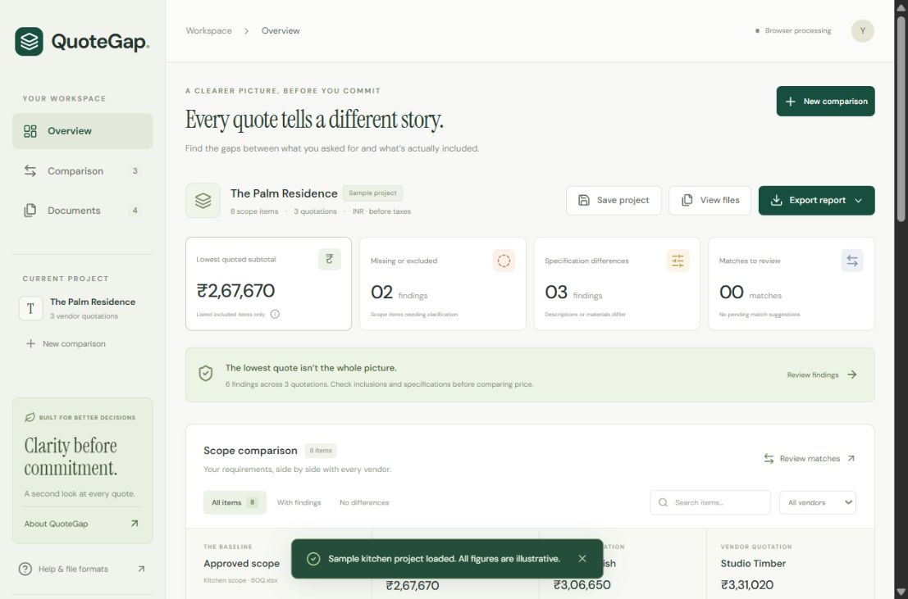

# QuoteGap

**Find what is missing before approving a contractor quotation.** A working comparison tool for Indian interior-design studios, initially focused on modular kitchens.



**Repository:** [Manideep711/QuoteGap](https://github.com/Manideep711/QuoteGap) · **Private preview:** [QuoteGap](https://quotegap-studio.veerasimha69.chatgpt.site)

[](https://render.com/deploy?repo=https://github.com/Manideep711/QuoteGap)

The preview currently requires the owner's ChatGPT access and is not an unrestricted judge-facing demo. Public hosting/access and a recorded demo video still need to be arranged before submission. Render Workflows integration is implemented but has not been run in a live Render account.

**EYFI build submission:** [copy-ready project fields](docs/SUBMISSION.md) · [demo video script](docs/DEMO_SCRIPT.md). There is no recorded video or claimed customer traction in this repository.

## Use the product

The default kitchen project is clearly labelled illustrative sample data. Upload an approved scope and 1–3 vendor quotations as CSV or XLSX; confirm suggested item matches; inspect source-row evidence; export CSV or print/save the complete report as PDF.

Supported columns: `Code` (optional unique item identifier), `Item`, `Specification`, `Quantity`, `Unit`, `Rate` (required column for quotations; blanks become review findings), `Included` (`Yes`/`No`), and `Notes`. Scope needs Item, Quantity, Unit. The first XLSX worksheet is read; formula cells are rejected—paste values first. Limits: 500 items and 5 MB per file, 3 quotations per project. Prices are INR before taxes. Sample files are in `public/examples/` in both formats.

Browser mode works without an account or API key. Files and projects remain in memory and disappear on refresh. Use Save project to download a QuoteGap JSON file, then reopen it from New comparison to restore your data and reviewed mappings. Download a report when ready. Original files are not sent to a server in this mode. External font requests use Google Fonts; system fonts are the fallback.

## Local development

Requires Node.js 22+ and npm.

```sh
npm ci
npm run dev
```

```sh
npm test
npm run build
npm run server
```

`npm run server` serves the production build and `/api/health`, `/api/compare` on port 3001 (or PORT). Without Render configuration its API runs the same matching code locally. Static Sites publication runs browser processing; it does not by itself deploy anything to Render.

## Render Workflows deployment

The genuine Workflows integration is in `server/tasks.ts` and `server/workflow.ts`, using `@renderinc/sdk`. `compare-project` fans out `compare-vendor` tasks with `Promise.all(ctx.run(...))`: one isolated task per vendor file. Each task validates input, suggests exclusive item matches, computes findings and subtotal; the root task aggregates results. Retries are bounded and the browser still allows humans to correct mappings. This integration must be deployed to your Render account to demonstrate sponsor usage; registration/import tests are not a live workflow run.

1. Put this directory in a GitHub repository and connect the included `render.yaml` Blueprint. If using a parent repository, set both services' `rootDir` to `quote-gap`.
2. Deploy the Workflow service. Copy its actual `compare-project` task slug from the Render dashboard, usually `<workflow-slug>/compare-project`.
3. Configure **server-only** `RENDER_API_KEY`, `RENDER_TASK_SLUG` and `API_ACCESS_TOKEN` on the web service. The Blueprint generates a pilot access token. Never put a Render key or token in a VITE environment variable or commit it to Git.
4. The web build uses `VITE_API_URL=.` to call its same-origin API. Browser processing remains available by default. Select Use Render Workflows in the upload dialog and enter the private pilot access token to run a comparison on Render. The token is kept only in form memory. The separate static Sites build stays in browser mode unless rebuilt with a configured API. Cross-origin API access is intentionally not enabled.
5. Upload the examples. The indicator changes to **Render Workflows** only after a successful real workflow result. Capture the root and parallel child runs in Render's dashboard for the demo. API requests are limited to five per minute per IP, 2 MB JSON, and three quotations. Paid execution is disabled without a pilot token. Put proper user authentication, per-user quotas and persistent jobs in place before a public paid launch.

The API waits up to four minutes and attempts to cancel failed/timed-out root runs. It never silently falls back to browser mode after a Render failure. Task inputs/results are retained under Render's own retention policy; avoid uploading confidential client data without authorization. No workflow state is persisted by this app's API. Refreshing or disconnecting the browser can lose UI state; long-term project storage is out of scope.

Official references: [Workflows](https://render.com/docs/workflows), [TypeScript SDK](https://render.com/docs/workflows-sdk-typescript), [pricing](https://render.com/docs/workflows-limits).

## Matching and calculations

- Unique shared codes auto-match. Exact descriptions and conservative token overlap produce unconfirmed suggestions. All shared-code matches are reserved before exact descriptions, and all exact descriptions before fuzzy suggestions. A quotation row is never assigned twice.
- Review controls permit unmapping and remapping. A confirmed mapping establishes row correspondence, not material equivalence.
- Checks compare description, specification, quantity, units, inclusion and missing price. String differences are review findings, not claims of inferior quality.
- Subtotals sum **all listed included quotation rows**, including unmapped extras. Explicitly excluded lines contribute zero; unpriced included lines mark the total incomplete. Incomplete totals are not eligible for the lowest-listed marker. Totals can describe different scope and are not adjusted to an equivalent basis.
- CSV exports escape formula-like strings. Print reports contain all scope items regardless of UI filters, notes, extras and original row references.

## Buyer and revenue hypothesis

Buyer: owner/procurement lead at an interior-design studio comparing modular-kitchen vendor quotations. Proposed pilot: **₹999 per project**; possible studio plan ₹2,999/month for five projects. No payments are collected, no customer outreach has been performed, and no revenue or traction is claimed. Validate willingness to pay before expanding formats or charging a subscription.

## Failure cases and limitations

1. Similar wording can describe different work. Shared codes may be reused incorrectly across vendors. Review original sources and mapping decisions.
2. Different units, material synonyms, bundled work, taxes, discounts, delivery and negotiated exceptions are not normalized automatically. No automatic vendor recommendation or savings claim.
3. Unsupported PDFs, scans, formula workbooks, nested headers, multiple-sheet templates and inconsistent column formats must be converted to the supported value-only format.
4. Missing prices are unknown, never inferred; missing inclusion defaults to included because there is no evidence of exclusion. Put explicit exclusions in Included=No and preserve caveats in Notes. All notes require human reading.
5. Browser mode is tab-memory only. Render mode requires actual account configuration; source readiness does not prove live execution. This is a private pilot, not a multi-tenant production billing platform.

## Suggested demo (under five minutes)

- 0:00–0:35: show the buyer's problem: ₹2,67,670 appears cheapest, but has excluded handles/installation and changed plywood/hinges.
- 0:35–1:25: upload sample spreadsheets; show source-row evidence and differences.
- 1:25–2:10: demonstrate missing/excluded filter, search, and correcting an item match.
- 2:10–2:50: export CSV and print/PDF.
- 2:50–3:35: after deploying Render, show root task and vendor tasks executing in parallel. Otherwise explicitly state the integration is not deployed.
- 3:35–4:30: buyer, price hypothesis, unvalidated traction, failure cases and next step.

## Stack and licensing

React, Vite, Lucide, Papa Parse, ExcelJS, Express and Render's TypeScript SDK. No paid AI APIs, GPUs or training datasets. Source code: MIT; dependencies retain their respective licenses.
